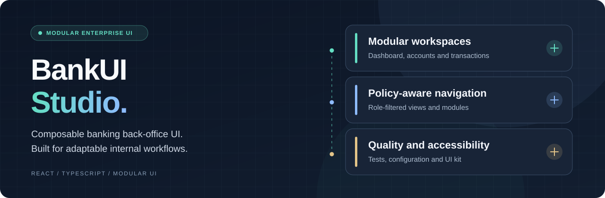

# Modular BankUI Studio

**A modular React and TypeScript frontend for banking back-office workflows.**

[Français](README.fr.md) · [Features](#features) ·
[Quick start](#quick-start) · [Architecture](#architecture) ·
[Security](#security-and-limitations) · [FAQ](#frequently-asked-questions)

[](LICENSE)


> **Frontend only.** This is a reference implementation of modular
> back-office interfaces, not a banking backend or a certified banking system.
> Production use requires properly secured APIs and an independent assessment.

## Overview

Modular BankUI Studio is a configurable frontend for internal banking
applications. It groups common back-office screens into reusable modules,
with shared components, role-aware navigation and validated client settings.

**Who is it for?** Frontend developers, product teams and organizations
prototyping or integrating financial-services back-office interfaces.

The goal is to reduce repetitive UI work without tying the presentation layer
to a specific banking backend.

## Features

- **Modular workspaces:** dashboard, accounts, transactions, approvals,
  users and roles, reports, and audit screens.
- **Configurable branding:** client-specific themes and module selection.
- **Validated settings:** Zod checks the client configuration on startup.
- **Role-aware navigation:** routes and menus depend on configured permissions.
- **Reusable UI components:** shared layout, cards, controls and lists.
- **Integration contracts:** documented adapters for external REST APIs.
- **Testing tools:** Vitest, Playwright and accessibility-oriented checks.

### Example workflow

Choose the modules a team needs, configure the theme and connect the
frontend adapters to the organization's authenticated APIs. The browser
provides the interface; the backend remains responsible for business rules
and access control.

## Architecture

The codebase uses a pnpm workspace:

- `apps/starter/` — React application and module registry.
- `packages/ui/` — reusable interface components.
- `docs/` — architecture, security and integration guidance.

**Technology:** React 18, TypeScript, Vite, Zod, Tailwind CSS, DOMPurify,
Vitest, React Testing Library, Playwright and axe-core.

The project separates interface configuration, navigation, rendering and API
adapters. It does not include a complete banking backend.

## Quick start

**Requirements:** Node.js 20 and pnpm 9, matching the existing CI setup.

```bash
git clone https://github.com/hrmonic/banktestapp.git
cd banktestapp
pnpm install --frozen-lockfile
pnpm dev
```

Useful development commands:

```bash
pnpm build
pnpm exec vitest run
pnpm test:security
pnpm test:e2e
```

The E2E suite requires the Playwright browsers to be installed.
A GitHub Pages workflow publishes a frontend demonstration; it does not
provide a production banking API.

## Security and limitations

The repository includes frontend safeguards such as configuration validation,
HTML sanitization, session handling, permission-aware UI and security tests.

Keep the following boundaries in mind:

- Client-side permission checks are **not** backend authorization.
- Financial regulations, identity infrastructure and business logic belong
  to the integrating service.
- The project is **not** presented as security-certified or production-ready.
- The current `pnpm lint` command uses `--fix` and may change source files.
- Review dependencies and environment-specific settings before deployment.

## Documentation

- [Architecture](docs/architecture.md)
- [API contracts](docs/api-contracts.md)
- [Security hardening](docs/security-hardening.md)
- [Accessibility checklist](docs/ui-accessibility-checklist.md)
- [Historical project README](docs/README-archive.md)

## Roadmap

- [ ] Add verified screenshots of the application.
- [ ] Publish a working end-to-end demo with a sample backend.
- [ ] Separate lint checks from automatic formatting.
- [ ] Expand tests for external API integration.

## Frequently asked questions

### Does this project contain a banking backend?

No. It is a modular frontend and documents integration boundaries for
services provided separately.

### Can the interface be customized?

Yes. Client configuration controls branding and which modules are enabled.

### Does the UI role system secure an API?

No. Backend endpoints must enforce permissions independently of the UI.

### Can a company use the code commercially?

Commercial use requires prior written permission under the repository's
custom license. Review [LICENSE](LICENSE) before reuse.

## License

**Source available under custom terms.** The included license is a modified
MIT-style license with a commercial-use restriction. It is **not** the
standard MIT license or an OSI-approved open-source license.

Copyright © 2026 Réda Touzani.

---

Created and maintained by [Réda Touzani](https://github.com/hrmonic).
